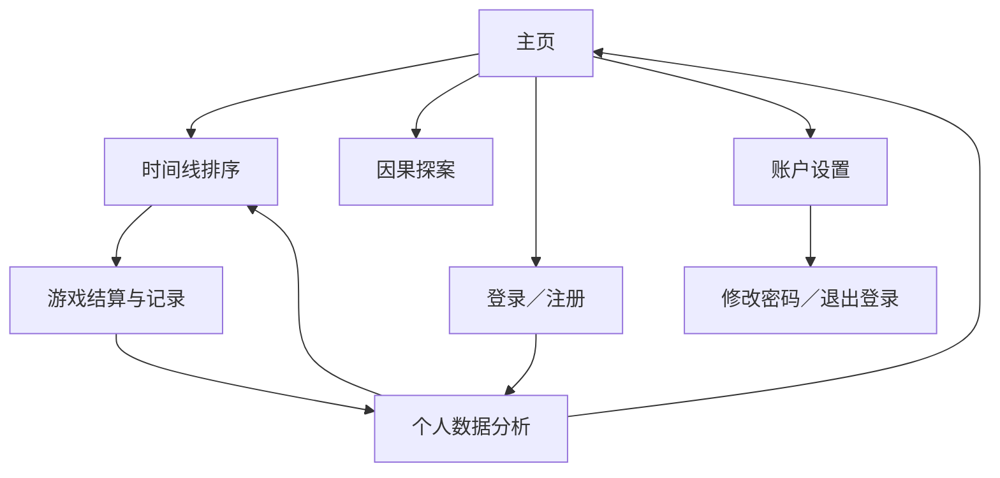

# CHRONOS AP 世界史时间线游戏产品需求文档

> 文档类型：产品需求文档（PRD）  
> 产品名称：CHRONOS · AP World History: Modern  
> 覆盖范围：主页、用户注册与登录、个人数据分析、时间线排序游戏  
> 文档状态：最终版功能归档  
> 当前题库规模：400 个事件

## 1. 文档目的

本文档根据项目从初版上线到当前版本的连续迭代记录编制，用于：

1. 说明 CHRONOS 的产品定位、目标用户与核心使用路径；
2. 归档主页、账户系统、数据分析页和时间线游戏从初版到最终版的主要改动；
3. 明确当前版本的功能、数据口径、交互规则和异常处理机制；
4. 为后续开发、测试、题库维护和产品验收提供统一依据。

## 2. 产品概述

### 2.1 产品定位

CHRONOS 是一款围绕 AP World History: Modern 考纲设计的网页学习游戏。产品以“时间线排序”为核心玩法，并通过账户记录和个人数据分析，将一次性的历史知识挑战转化为可以长期积累、诊断和复习的学习系统。

### 2.2 目标用户

- 正在学习 AP World History: Modern 的学生；
- 希望建立世界史年代框架和事件关联的学习者；
- 希望通过游戏记录识别个人知识强项与薄弱区域的用户；
- 不愿注册、只希望立即体验的游客用户。

### 2.3 核心产品目标

- 降低进入门槛：不登录也能立即游戏；
- 保留学习轨迹：登录用户可持久化保存游戏成绩与事件级作答记录；
- 对齐考纲：题库规模、单元比例与内容覆盖符合 AP 世界史考纲；
- 提供诊断：从时间、地区、事件类型和具体事件层面分析学习表现；
- 保证可靠性：生命值归零时立即结算，并对网络失败进行补写和去重。

## 3. 产品信息架构

### 3.1 核心用户路径

**游客路径：**进入主页 → 选择时间线排序 → 选择语言、难度、地区和单元 → 游戏 → 结果保存在当前浏览器。

**登录用户路径：**进入主页 → 登录或注册 → 游戏 → 生命值归零或题库完成 → 记录写入账户 → 点击用户名进入数据分析 → 根据薄弱项继续挑战。

## 4. 版本演进总览

| 阶段 | 主要改动 | 形成的产品效果 |
|---|---|---|
| 初版 | 发布单一的 AP 世界史时间线排序游戏 | 用户可进行基础事件年代排序挑战 |
| 主页化 | 新增 CHRONOS 游戏选择主页，并加入“因果探案”入口 | 产品由单页游戏升级为多游戏学习入口 |
| 导航修复 | 修复主页游戏入口，以及子页面左上角返回和用户名按钮 | 主页、子页面和账户入口形成稳定导航闭环 |
| 账户系统 | 新增注册、登录、修改密码、退出登录、游客模式和管理员初始化 | 游客可低门槛使用，注册用户可持久化保存记录 |
| 账户稳定性 | 修复管理员初始化失败、登录成功后误报“账号服务暂时不可用”等问题 | 管理员与普通用户均可稳定登录，登录状态能够正确刷新 |
| 数据分析 | 新增个人时间线数据分析页，接入概览、时间、地区、事件类型与单事件统计 | 游戏从“练习工具”升级为“学习诊断工具” |
| 交互重构 | 用户名按钮直达数据分析，账户设置单独承载改密与退出 | 数据分析与账户管理职责分离，路径更直接 |
| 图表优化 | 三个统计板块统一为竖向柱状图，地区和事件类型按正确率降序排列 | 统计结果更易比较，页面信息层级更清晰 |
| 页面紧凑化 | 消除横向滚动，连续压缩卡片和图表高度，放大关键标签 | 在保持可读性的同时减少页面长度，提高桌面端和移动端适配性 |
| 记录可靠性 | 生命值降至 0 时即时结算，增加唯一局编号、待提交队列、失败补写和服务端去重 | 避免结算动画、跳转、刷新或网络波动导致成绩丢失或重复 |
| 趋势分析 | 新增最近 10 局得分折线图；“每百年正确率”调整为“时间正确率”，区间改为世纪名称 | 用户可同时查看短期表现趋势和长期年代知识结构 |
| 题库重构 | 题库由 250 扩充到 400；按考纲重配单元比例；难度池调整为 50／100／200／300／400 | 降低 1900 年后事件过度集中，形成稳定的分层题库体系 |

## 5. 功能需求：主页

### 5.1 初版状态

初版产品以单一时间线游戏页面为主，缺少统一的产品首页，也没有明确区分不同游戏模式、账户入口和学习数据入口。

### 5.2 迭代内容

1. 新建 CHRONOS 品牌主页，统一呈现 AP World History: Modern 的产品定位；
2. 增加两张游戏入口卡片：
   - “时间线排序”：年代判断、事件排序和即时反馈；
   - “因果探案”：基于历史事件因果关系进行推理挑战；
3. 修复主页游戏入口无法可靠跳转的问题；
4. 在右上角加入账户入口：
   - 未登录时显示“游客模式”，点击打开登录／注册面板；
   - 已登录时显示用户名，点击直接进入个人数据分析页；
   - 已登录状态旁单独显示“账户设置”按钮；
5. 统一主页与游戏子页面的视觉语言，包括深色历史氛围、时间线元素、卡片动效和响应式布局。

### 5.3 最终效果

主页成为产品的统一分发中心。用户能够在首屏完成游戏选择、识别登录状态，并快速进入个人数据分析或账户设置。主页不要求登录，不阻断游客的游戏路径。

### 5.4 验收标准

- 点击“时间线排序”可进入时间线游戏；
- 点击“因果探案”可进入因果探案游戏；
- 未登录用户点击“游客模式”可打开登录／注册面板；
- 登录用户点击用户名可直接进入数据分析页；
- 登录用户点击独立设置按钮可修改密码或退出登录；
- 桌面端与移动端均无关键元素遮挡或横向溢出。

## 6. 功能需求：用户注册、登录与账户设置

### 6.1 初版状态

初版无账户体系，用户成绩仅存在于单次游戏或当前设备，无法形成跨局、跨时间的个人学习画像。

### 6.2 功能范围

#### 6.2.1 游客模式

- 用户无需注册或登录即可进入全部游戏；
- 游客完成记录保存在当前浏览器本地缓存；
- 登录服务异常时，游客模式仍保持可用；
- 游客数据不自动混入已登录账户的云端统计。

#### 6.2.2 注册

- 用户名长度为 3—32 个字符；
- 密码最少 8 位；
- 用户名采用规范化值进行唯一性校验；
- 注册成功后自动登录；
- 默认账户角色为普通用户。

#### 6.2.3 登录

- 用户通过用户名和密码登录；
- 登录成功后刷新页面账户状态；
- 用户名按钮显示“用户名”，管理员显示“用户名 · 管理员”；
- 登录会话通过安全 Cookie 维持。

#### 6.2.4 账户设置

- 已登录用户可修改密码；
- 修改密码需要输入当前密码、新密码及确认密码；
- 修改成功后，其他设备上的既有会话失效；
- 用户可主动退出登录，退出后切回游客模式。

#### 6.2.5 管理员账户

- 系统初始化管理员用户名为 Bill；
- 管理员密码由项目方预设，不在前端或本文档中明文保存；
- 管理员账户在数据库初始化时自动创建；
- 当前版本仅展示管理员身份，尚未开放独立后台管理功能。

### 6.3 安全与稳定性迭代

1. **管理员初始化失败修复：**初版密码哈希迭代次数超过运行平台上限，导致管理员记录未写入；最终调整为平台支持的安全参数并完成自动初始化。
2. **登录误报修复：**服务器已返回登录成功，但前端在异步回调后访问失效的表单事件对象，导致界面误报“账号服务暂时不可用”；最终改为提前保存表单引用，并在成功后正确刷新账户状态。
3. **密码安全：**密码以加盐哈希形式保存，不在数据库中保存明文密码。
4. **会话安全：**服务器保存会话令牌哈希，并设置过期时间；修改密码后清理其他会话。
5. **写入保护：**游戏记录接口校验同源请求、用户登录态、游戏类型、分数范围与数据大小。

### 6.4 最终效果

产品形成“双轨数据模式”：游客以本地缓存低门槛使用，登录用户以账户持久化保存学习记录。账户入口、数据分析入口和设置入口相互独立，避免一个按钮同时承担过多职责。

### 6.5 验收标准

- 新用户可以完成注册并自动登录；
- 已有用户输入正确凭据后显示登录成功，不再误报服务不可用；
- 管理员账户能够登录并正确显示管理员身份；
- 修改密码后可使用新密码重新登录；
- 退出后恢复游客模式；
- 账户服务失败不影响游客继续游戏；
- 密码与会话凭证不得以明文写入前端代码或数据库。

## 7. 功能需求：个人数据分析页

### 7.1 初版状态

初版只提供单局得分和游戏反馈，没有跨局数据汇总，也无法判断用户在不同年代、地区、事件类型或具体事件上的掌握程度。

### 7.2 页面入口与权限

- 仅登录用户可查看个人数据分析；
- 主页和游戏子页面中的用户名按钮均直接跳转到数据分析页；
- 未登录访问时显示登录引导；
- “修改密码”和“退出登录”保留在独立账户设置中；
- 数据分析页提供“返回首页”和“继续挑战”按钮，分别返回主页和时间线游戏。

### 7.3 数据概览

页面顶部以 5 个紧凑数据格展示：

1. 总游戏局数；
2. 每局平均分；
3. 历史最高分；
4. 历史最高连续答对数；
5. 题库覆盖度。

题库覆盖度计算公式为：

$$
\text{题库覆盖度}=\frac{\text{用户历史游戏中见过的去重事件数}}{400}\times100\%
$$

顶部数据格在迭代中删除了无内容的上方占位区域，并缩短高度，以减少首屏空白。

### 7.4 最近得分趋势

- 在“时间正确率”板块上方展示最近 10 局游戏得分折线图；
- 数据从左到右按游戏完成时间排列，最新一局位于最右侧；
- 不足 10 局时展示已有记录；
- 图表采用紧凑高度，避免显著增加页面长度。

### 7.5 时间正确率

- 原名称“每百年正确率”最终调整为“时间正确率”；
- 统计范围为 13 世纪至 21 世纪；
- 每个事件按发生年份归入相应世纪；
- 以竖向柱状图展示正确率；
- 柱状图同时显示世纪名称、正确率和“答对次数／出现次数”。

### 7.6 地区正确率

地区包括：

- 东亚；
- 伊斯兰世界；
- 南亚与东南亚；
- 美洲；
- 非洲；
- 欧洲；
- 跨区域／全球。

统计规则：

- 每次事件作答均计入其所属地区；
- 跨地区事件同时计入多个地区；
- 各地区按有数据优先、正确率降序、出现次数降序排列；
- 采用无横向滚动条的响应式竖向柱状图。

### 7.7 事件类型正确率

“主类别”最终统一更名为“事件类型”。主要类型包括：

- 政治；
- 经济；
- 军事；
- 思想／文化；
- 科技；
- 社会；
- 环境／公共卫生。

每个事件只设置一个主要事件类型。类型统计按正确率降序展示，并以竖向柱状图呈现。最终版本同时修复了英文关键词误判问题，例如避免把“European”中的字符片段错误识别为“Euro”经济类事件。

### 7.8 单个事件分析

页面底部展示：

- 掌握最好的 5 个事件；
- 最需要复习的 5 个事件。

每个事件显示：

- 事件名称；
- 发生年份；
- 事件类型；
- 正确率；
- 答对次数／出现次数。

排序规则：

- 最强事件优先按正确率降序，再按出现次数降序；
- 最弱事件优先按正确率升序，再按出现次数降序。

### 7.9 历史数据兼容

- 旧记录继续计入总局数、平均分和最高分；
- 若旧记录缺少事件级字段，则不参与时间、地区、事件类型和单事件精细统计；
- 页面向用户说明旧记录与详细记录的统计边界；
- 题库扩充后，题库覆盖度分母由 250 同步更新为 400。

### 7.10 视觉与布局演进

1. 将时间、地区和事件类型统计统一为竖向柱状图；
2. 地区与事件类型两个并列板块的总宽度与上下单栏板块严格对齐；
3. 移除固定最小图表宽度和柱体最小宽度，消除横向滚动条；
4. 多轮压缩卡片高度、图表高度、模块间距和上下留白；
5. 单独放大类别名、作答数字、事件名称、年份和事件类型字号；
6. 页面标题最终由“时间线学习画像”调整为“时间线游戏数据分析”。

### 7.11 验收标准

- 登录用户可正常加载所有统计模块；
- 顶部 5 项指标与历史记录一致；
- 最近 10 局折线图顺序正确；
- 时间标签显示为 13—21 世纪；
- 地区和事件类型按正确率降序排列；
- 三组柱状图均为竖向、无横向滚动；
- 返回首页和继续挑战按钮均可点击；
- 新增事件完成作答后可进入对应统计；
- 覆盖度以 400 为分母且去重计算。

## 8. 功能需求：时间线排序游戏

### 8.1 核心玩法

1. 用户从题库中获得一张隐藏年份的历史事件卡片；
2. 用户将事件插入已有时间轴的正确位置；
3. 答对后显示年份与百科链接，并增加得分和连续答对数；
4. 答错后扣除 1 点生命值；
5. 初始生命值为 3；
6. 生命值降至 0 或当前事件池耗尽时结束本局；
7. 结算后用户可以回顾本局时间线。

### 8.2 语言

- 支持英文和中文界面；
- 事件字段同时包含英文标题、英文提示、中文标题和中文提示；
- 语言切换同步更新游戏说明、筛选项、按钮和事件内容。

### 8.3 筛选体系

用户可组合选择：

#### 难度

| 难度 | 重要性范围 | 全部地区、全部单元下的事件数 |
|---|---|---:|
| 青铜 | S 级 | 50 |
| 白银 | S—A 级 | 100 |
| 黄金 | S—B 级 | 200 |
| 铂金 | S—C 级 | 300 |
| 钻石 | S—D 级 | 400 |

#### 地区

全部地区、东亚、伊斯兰世界、南亚及东南亚、美洲、非洲、欧洲、全球／跨地区。

#### AP 单元

第 1—9 单元及“全部单元”。

#### 组合筛选规则

最终事件池同时满足：

1. 事件重要性达到当前难度门槛；
2. 事件属于当前所选地区，或用户选择全部地区；
3. 事件属于当前所选 AP 单元，或用户选择全部单元。

页面实时显示筛选后的事件数量。

### 8.4 题库从 250 题扩充到 400 题

#### 8.4.1 扩充原因

对原 250 题进行审计后发现：

- 1900 年后事件为 96 题，占 38.4%；
- 第 7—9 单元合计 94 题，占 37.6%；
- AP 考纲中第 7—9 单元合计权重为 24%—30%；
- 原题库对 1900 年后的内容配置明显偏高，而第 1—3 单元相对薄弱。

#### 8.4.2 最终单元分配

| AP 单元 | 事件数 | 占比 | 考纲权重范围 |
|---|---:|---:|---:|
| 第 1 单元：全球格局 | 36 | 9.00% | 8%—10% |
| 第 2 单元：交流网络 | 36 | 9.00% | 8%—10% |
| 第 3 单元：陆基帝国 | 55 | 13.75% | 12%—15% |
| 第 4 单元：跨洋互联 | 55 | 13.75% | 12%—15% |
| 第 5 单元：革命时代 | 55 | 13.75% | 12%—15% |
| 第 6 单元：工业化的影响 | 55 | 13.75% | 12%—15% |
| 第 7 单元：全球冲突 | 36 | 9.00% | 8%—10% |
| 第 8 单元：冷战与非殖民化 | 37 | 9.25% | 8%—10% |
| 第 9 单元：全球化 | 35 | 8.75% | 8%—10% |
| 合计 | 400 | 100% | — |

最终结果：

- 第 7—9 单元合计 108 题，占 27%，符合考纲；
- 按实际发生年份计算，1900 年后事件共 111 题，占 27.75%；
- 新增内容重点补足国家建构、交流网络、陆基帝国治理、跨洋贸易与强迫劳工、革命思想、帝国主义和全球化等考纲主题。

### 8.5 事件数据结构

每个事件保持统一的 9 字段结构：

| 字段 | 说明 |
|---|---|
| year | 事件年份 |
| title | 英文标题 |
| hint | 英文提示 |
| wiki | 百科条目标识 |
| regions | 一个或多个地区代码 |
| importance | 重要性等级数值 |
| zh_title | 中文标题 |
| zh_hint | 中文提示 |
| unit | AP 单元编号 |

运行时进一步生成唯一事件 ID、重要性标签和事件类型，用于筛选、作答记录与数据分析。

### 8.6 结算与数据可靠性

#### 原问题

旧版本在答错反馈结束约 1.7 秒后才提交成绩。如果用户在此期间刷新、关闭或跳转页面，可能出现“游戏已经结束，但统计中没有记录”的情况。

#### 最终机制

1. 生命值从 1 降至 0 的同一事件循环中立即生成结算记录；
2. 每局生成唯一 UUID 作为结果编号；
3. 登录用户向服务器提交完整记录；
4. 未登录用户写入游客本地记录；
5. 请求失败时写入本地待提交队列；
6. 用户下次进入游戏时自动补写；
7. 服务端通过结果编号执行“插入或忽略”，防止同一局被重复统计；
8. 待提交队列限制保留最近 20 条，避免无限增长。

### 8.7 单局记录字段

时间线游戏结算记录至少包括：

- 唯一结果编号；
- 游戏类型；
- 分数；
- 答对数与作答总数；
- 本局最高连续答对数；
- 剩余生命值；
- 地区筛选；
- AP 单元筛选；
- 难度；
- 总题库规模；
- 本局见过的事件 ID；
- 每次作答对应的事件 ID、年份、标题、地区、事件类型和对错结果。

### 8.8 子页面导航

时间线子页面左上角提供：

- 返回按钮：返回主页；
- 用户名／游客按钮：登录用户进入数据分析，游客返回主页并打开账户面板；
- 账户设置按钮：仅登录用户显示，返回主页并打开账户设置。

这些控件最终改为独立的原生页面导航，并提高交互层级，避免嵌入式游戏页面抢占点击。

### 8.9 验收标准

- 全部事件池总数为 400；
- 五档难度池分别为 50／100／200／300／400；
- 第 1—9 单元事件数符合最终分配表；
- 地区、单元和难度组合筛选结果正确；
- 事件字段无缺失、无重复标题、地区和单元代码合法；
- 中文与英文事件内容均可正常加载；
- 生命值降为 0 时立即触发结算与记录；
- 网络失败后能够补写，重复补写不会增加局数；
- 返回、用户名和账户设置按钮均可点击。

## 9. 数据与技术要求

### 9.1 核心数据实体

| 实体 | 关键字段 | 用途 |
|---|---|---|
| 用户 | 用户 ID、用户名、规范化用户名、密码哈希、盐值、角色、创建／更新时间 | 身份认证与角色识别 |
| 会话 | 会话令牌哈希、用户 ID、过期时间、创建时间 | 维持安全登录状态 |
| 游戏结果 | 结果 ID、用户 ID、游戏类型、分数、详细数据、完成时间 | 持久化学习轨迹与分析数据 |
| 游客记录 | 本地浏览器缓存 | 支持不登录游玩 |
| 待提交记录 | 本地浏览器队列 | 网络失败时延迟补写 |

### 9.2 数据隔离

- 每名登录用户只能读取自己的游戏结果；
- 游客数据仅保存在当前浏览器；
- 普通用户和管理员的学习统计采用同一数据口径；
- 管理员角色当前不改变游戏和分析权限。

### 9.3 性能与兼容性

- 首页和游戏页面应适配桌面端与移动端；
- 400 题题库加载后，筛选与抽题应保持即时响应；
- 图表不得依赖横向滚动才能查看完整类别；
- 账户服务异常不应阻断游客游戏；
- 旧游戏记录不得因数据结构升级而导致整个分析页加载失败。

## 10. 最终产品效果

当前版本已经形成完整的“进入—练习—记录—分析—再练习”闭环：

1. **主页层：**统一呈现品牌、游戏入口与账户状态；
2. **身份层：**兼容游客与登录用户，提供注册、登录、改密和退出；
3. **游戏层：**以 400 个符合 AP 考纲比例的事件构成五档难度题库，并支持地区与单元组合筛选；
4. **数据层：**在生命值归零时即时记录，通过失败补写和唯一编号保证数据可靠；
5. **分析层：**展示总体成绩、最近 10 局趋势、时间／地区／事件类型正确率，以及具体事件强弱项；
6. **导航层：**主页、游戏、分析和账户设置之间均有明确且可用的跳转路径。

产品由最初的单一时间线小游戏，最终演进为具备内容分层、账户持久化、学习分析和可靠数据闭环的 AP 世界史学习平台。

## 11. 当前版本之外的功能边界

以下功能尚未包含在本版交付范围内：

- 管理员题库编辑后台；
- 用户找回密码或邮箱验证；
- 游客历史记录自动合并到登录账户；
- 社交排行榜、好友或班级功能；
- 数据导出；
- 因果探案的独立个人分析页；
- 基于薄弱单元自动生成的个性化复习计划。

上述内容如进入下一阶段，应在保持现有账户、记录去重、题库分层和统计口径兼容的前提下另立需求。

